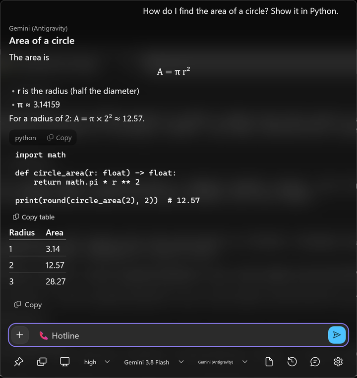
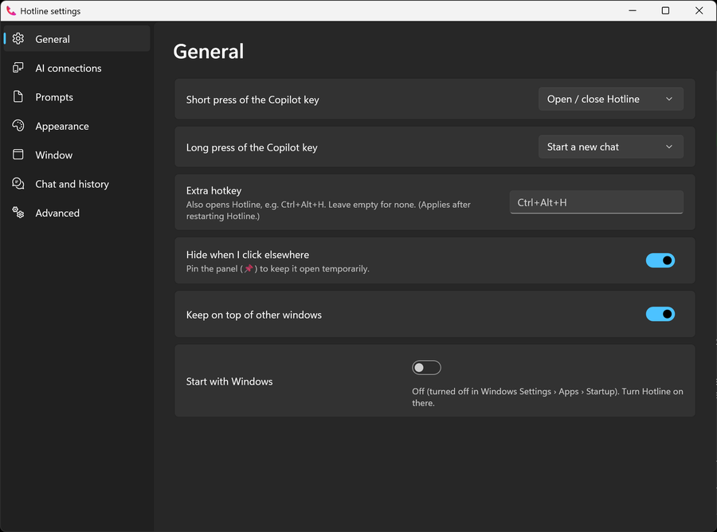

# Hotline

[](https://github.com/sponsors/PMARC14)
[](https://ko-fi.com/pmarc14)

**You are stuck with the key might as well use it. Gives you an option to replace the Windows Copilot key with your own fast, native AI popup that talks to the AI *you* choose.**

Hotline uses the AI tools you already have (your
installed Claude Code, Codex or Antigravity CLI and their sign-ins) or any API key you bring, and keeps everything
configurable in plain files.

<p align="center">
  
</p>

> Status: pre-1.0 — used daily, expect rough edges. Windows 11 only. Apache-2.0.

## Features

- **The Copilot key** — short press opens/closes, long press starts a new chat (both configurable), plus an
  optional extra hotkey. Opens on the monitor you're working on, focused and ready to type.
- **Your choice of AI** — pick *Effort → Model → Provider* in the bar:
  - **Claude Code** (your Claude plan, no API key), **OpenAI Codex CLI** (your ChatGPT plan) and **Antigravity CLI / agy**
    (Gemini with your Google sign-in)
  - **Anthropic API**, **Gemini API**, **OpenAI-compatible** APIs (OpenAI, OpenRouter, …)
  - **Local models** through any OpenAI-style server (llama.cpp's `llama-server`, LM Studio, vLLM)
- **Native and light** — WinUI 3 with acrylic, no embedded webview2.
- **In your language** — follows Windows, or pick one in Settings › General: English, Español, Français, Deutsch,
  Italiano, Português (Brasil), Nederlands, Polski, Українська, Türkçe, 日本語, 한국어, 简体中文, 繁體中文, हिन्दी,
  Bahasa Indonesia, Tiếng Việt. The translations are machine-drafted; fixes are welcome ([TRANSLATING.md](docs/TRANSLATING.md)).
- **Rich answers** — Markdown with headings, lists, tables, code (with Copy), math (LaTeX → readable symbols), inline
  SVG drawings, and the whole conversation selectable in one drag.
- **Screens and files** — capture the window you were in, the whole screen, or a region you drag out; paste or drop
  images and files. Models that can't see images get the **text in the screenshot** instead (Windows' offline OCR).
- **Selected text comes along** — text you had selected in the app you came from is attached automatically (through
  UI Automation: no keystrokes, your clipboard untouched).
- **Quick actions** — type `/` for `/translate`, `/summarize`, `/fix`, `/explain`, or your own: each is a Markdown file
  in `actions\`.
- **Memory** — `/remember I prefer metric units` (or "remember that…" to an API model, which asks you first) saves a
  note to `memory.md`; every chat sees it, whichever AI you use.
- **Voice** — set the long press to *Voice input*, hold the key and talk; let go to stop.
- **Chat history** — the 🕘 button, Ctrl+↑ or `/resume` open a searchable list of your chats. A chat with Claude
  Code, Codex or Antigravity lives in that tool's own history (grouped under *Hotline*), shows its earlier messages
  when you reopen it, and picks up where it left off, even after
  a restart, and **Continue this chat in ▸** opens it in a terminal window.
- **Answers in the background** — ask something long, switch away, and a Windows notification says when it's ready.
- **Effort control** for every AI that has it (Claude, Gemini's thinking level, OpenAI reasoning effort); rate limits
  are retried for you, and Settings › AI connections › *Test connection* checks a key and model.
- **Tools, carefully** — API connections can use tools from your **MCP servers** (`mcp.json`, the same format other
  MCP apps use) and, when your Windows has it, the built-in **Windows agent connectors**. Read-only tools run; anything
  else asks you in the panel (*Allow once / Always / Deny*). CLI connections can use their own tools under their own
  permission rules.
- **System prompts** as Markdown files you can switch from the bar.
- **Your panel, your way** — hold Alt to move or resize it, save its spot as the default, pin it where you work; the
  chat grows up or down from the message bar. `toolbar.json` puts the buttons above or below the message box, in the
  order you like. Optional open/close sounds (a Windows sound or your own .wav).
- **Built-in guide** — Settings › Guide explains every feature; Settings › Advanced › Reset starts over (with a backup).
- **Everything is a file** — settings, one file per AI connection, prompts; edits apply instantly. API keys live in
  Windows Credential Locker.

<p align="center">
  
</p>

## Install

Windows 11 22H2 or later, on x64 or ARM64 (Windows on ARM runs the native ARM64 build).

### From the Microsoft Store

Search for **Hotline AI** in the Microsoft Store, or run `winget install 9PMW5CR6G3BC`. Store installs are signed by
Microsoft and update automatically (also through `winget upgrade`).

### From Releases

Download the latest `.msixbundle` from [Releases](https://github.com/PMARC14/Hotline/releases) and double-click it (Windows'
App Installer opens with an **Install** button). To get automatic updates instead, download `Hotline.appinstaller`
and open that.

> **GitHub releases are self-signed** (the Microsoft Store version is signed by Microsoft), so Windows refuses them
> until you trust `Hotline.cer` once (admin PowerShell, in the download folder):
> `Import-Certificate -FilePath .\Hotline.cer -CertStoreLocation Cert:\LocalMachine\TrustedPeople`.
> Releases from v0.2.24 on share one certificate (valid until 2036): trust it once, and installs from
> `Hotline.appinstaller` then update themselves.

The first time you open it, Hotline asks which AI to use: the ones installed on your PC (Claude Code, Codex,
Antigravity) or an API key. Nothing runs or is sent until you pick one.

Then assign the key: **Settings → Personalization → Text input → Customize Copilot key on keyboard → Custom →
Hotline**, or use the **Open Copilot key settings** button in Hotline (Settings › General). (Windows only lets packaged
apps take the Copilot key, which is why Hotline installs as a package.) Step by step and troubleshooting:
[docs/copilot-key.md](docs/copilot-key.md).

### From source

Requires the [.NET SDK 10.0.401+](https://dotnet.microsoft.com/download).

```bash
git clone https://github.com/PMARC14/hotline
cd hotline
scripts/dev-cert.sh   # once: creates a self-signed certificate and trusts it for sideloading (UAC)
scripts/install.sh    # builds, signs and installs Hotline, then starts it in the tray
```

Then assign the key as above.

## Using it

- **Copilot key** — open/close. **Long press** — new chat (or *Voice input*: talk while you hold it). **Esc** hides,
  **Ctrl+N** new chat.
- **/** at the start of a message — quick actions (`/translate some text`, or `/summarize` with an attachment).
- **Selected text** in the app you came from shows up as a chip; remove it with its ✕ if you don't want it.
- **+** / bar buttons — attach files, capture the window you were in, the whole screen, or a region. Ctrl+V pastes images.
- **📌 Pin** keeps the panel open while you drag files in.
- **⚙ Settings** — AI connections, prompts, appearance, window size, history, folders.

### Connecting an AI

| Connection | You need |
|---|---|
| Claude Code | [Claude Code](https://claude.com/claude-code) installed and signed in (run `claude` once) |
| OpenAI Codex | The [Codex CLI](https://github.com/openai/codex) installed and signed in (`npm install -g @openai/codex`, then `codex login`) |
| Antigravity (agy) | The [Antigravity CLI](https://antigravity.google/cli) installed and signed in (run `agy` once) |
| Anthropic / Gemini / OpenAI-compatible | An API key — Settings › AI connections › Add connection, paste the key, pick a model |
| Local | An OpenAI-style server running (e.g. `llama-server` on `http://127.0.0.1:8080`) |

Keys are only ever sent over https (plain http only to this PC).

### Configuration

All options, the file layout and the agy permission setup: **[docs/configuration.md](docs/configuration.md)**.

## What leaves your PC

Hotline has no server of its own and collects nothing. When you send a message, it goes to **the AI connection you
picked** (Anthropic, Google, OpenAI-style service, a local server, or your Claude Code / Codex / agy sign-in), together with:

- **attachments** in the message box — files, screenshots, and the **text you had selected** in the app you came from
  (it appears as a chip; remove it with ✕, or turn it off: Settings › Chat and history › Attach selected text);
- the **system prompt** and your **memory.md** notes (Settings › Chat and history › Memory);
- the **earlier messages** of the conversation, for context;
- **tool results**, when an API connection uses tools you allowed.

Nothing is sent until you press Enter (an App Action from Click to Do or a quick action from Windows sends at once, as
you asked it to). Voice uses Windows' own speech recognition (Microsoft's online service). OCR runs on your PC.
Chat history, settings and memory stay in `%USERPROFILE%\.hotline`; API keys stay in Windows Credential Locker and
only travel over https (plain http only to this PC). What each AI provider does with your data is set by its terms.
Full details: [PRIVACY.md](PRIVACY.md).

## Development

```powershell
dotnet test --project tests\Hotline.Core.Tests\Hotline.Core.Tests.csproj   # unit tests (Core)
powershell -File tests\smoke\smoke.ps1 [-Install]                         # end-to-end against the installed app
```

The smoke test drives the same inputs Windows uses (protocol links, Copilot key messages, the hotkey), renders a
scripted conversation off-screen and builds every settings page, then checks the log. It restores your settings.
Debug build: `scripts/install.sh --configuration Debug` (verbose log, key-status line). Crash dumps (opt-in, admin):
`scripts/enable-crash-dumps.sh`.

- **Layout:** `src/Hotline.Core` (UI-free logic: backends, settings, markdown, tools — fully unit-tested),
  `src/Hotline.App` (WinUI 3 app), `tests/`, `scripts/`, `docs/` (design spec, plans, handoff notes).
- **Contributors / new sessions:** start with [docs/HANDOFF.md](docs/HANDOFF.md).
- **Testing everything by hand:** [docs/TESTING.md](docs/TESTING.md).

### CI and releases

Every pull request and push to `main` is built and unit-tested (`.github/workflows/ci.yml`). Every code change merged
to `main` publishes a release `v<version.txt>.<next patch>` with the `.msixbundle` (x64 + ARM64), `Hotline.cer` and `Hotline.appinstaller`
(`.github/workflows/release.yml`), signed with Hotline's long-lived self-signed certificate (trust `Hotline.cer` once).
Details, signing and winget: [docs/RELEASING.md](docs/RELEASING.md).

## Roadmap

Windows 11 26H2 follow-ups, continuing a chat in a local web page
(llama.cpp), and native-speaker reviews of the translations. See [docs/HANDOFF.md](docs/HANDOFF.md).

## Support Hotline

Hotline is free, open source and made by one person, with no ads or tracking. If it saves you time, a donation keeps
it going: [GitHub Sponsors](https://github.com/sponsors/PMARC14) or [Ko-fi](https://ko-fi.com/pmarc14) (also in
Settings › About).

<a href="https://github.com/sponsors/PMARC14"></a>
<a href="https://ko-fi.com/pmarc14"></a>

## License

Apache-2.0 — see [LICENSE](LICENSE). Third-party components: [THIRD-PARTY-NOTICES.md](THIRD-PARTY-NOTICES.md)
(placeholder app icon from Microsoft's [Fluent Emoji](https://github.com/microsoft/fluentui-emoji), MIT).
