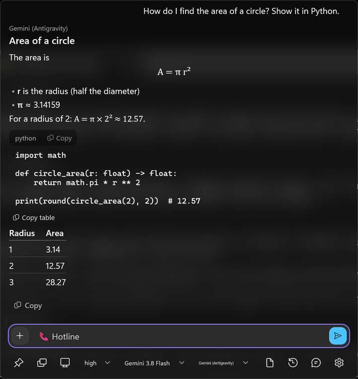
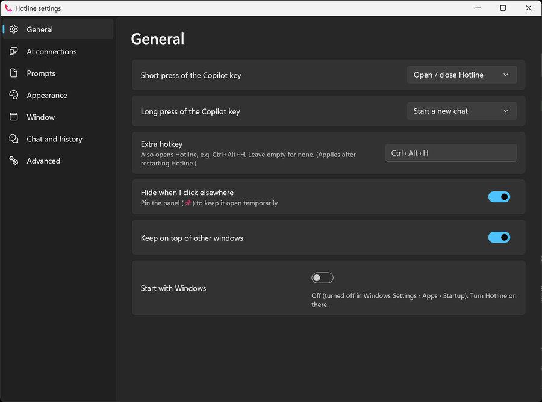

# Hotline

[](https://github.com/sponsors/PMARC14)
[](https://ko-fi.com/pmarc14)

**You are stuck with the key might as well use it. Gives you an option to replace the Windows Copilot key with your own fast, native AI popup that talks to the AI *you* choose.**

Hotline uses the AI tools you already have (your
installed Claude Code, Codex or Antigravity CLI and their sign-ins) or any API key you bring, and keeps everything
configurable in plain files.

<p align="center">
  
</p>

> Status: pre-1.0 — used daily, expect rough edges. Windows 11 only. Apache-2.0.

## Features

- **The Copilot key**: short press opens/closes, long press starts a new chat (both configurable), plus an optional extra hotkey.
- **Your choice of AI**: Claude Code, OpenAI Codex CLI and Antigravity CLI (agy) with their own sign-ins; Anthropic, Gemini and
  OpenAI-compatible APIs; local models through any OpenAI-style server (llama.cpp, LM Studio, vLLM). Pick Effort, Model and Provider in the bar.
- **Native and light**: WinUI 3 with acrylic, no embedded webview.
- **In your language**: follows Windows or Settings › General: English, Español, Français, Deutsch, Italiano, Português (Brasil),
  Nederlands, Polski, Українська, Türkçe, 日本語, 한국어, 简体中文, 繁體中文, हिन्दी, Bahasa Indonesia, Tiếng Việt. Machine-drafted,
  fixes welcome ([TRANSLATING.md](docs/TRANSLATING.md)).
- **Rich answers**: Markdown, tables, code with Copy, math, inline SVG, and the whole conversation selectable in one drag.
- **Screens and files**: capture a window, the screen or a region; paste or drop files; models that can't see images get the text (offline OCR).
- **Selected text comes along** through UI Automation, without keystrokes or touching your clipboard.
- **Quick actions** (`/translate`, `/summarize`, `/fix`, `/explain`, or your own Markdown files in `actions\`) and **memory** (`/remember`).
- **Voice**: set the long press to *Voice input*, hold the key and talk.
- **Chat history**: searchable (🕘, Ctrl+↑, `/resume`); CLI chats live in that tool's own history and resume after a restart.
  **Continue this chat in ▸** opens a chat in a terminal, Open WebUI, the llama.cpp web UI, LM Studio or any web page.
- **Notifications** when a long answer is ready while you are elsewhere.
- **Tools, carefully**: MCP servers (`mcp.json`) and Windows agent connectors for API connections; read-only tools run, the rest ask first.
- **System prompts** as Markdown files you can switch from the bar.
- **Your panel, your way**: Alt to move or resize, pin, grow up or down, button rows you arrange and add to (Settings › Window), open/close sounds.
- **Built-in guide** (Settings › Guide), Reset with a backup, and Backup export/import (never API keys).
- **Everything is a file**: edits apply instantly, a mistake costs only the wrong value, API keys live in Windows Credential Locker.

<p align="center">
  
</p>

## Install

Windows 11 22H2 or later, on x64 or ARM64 (Windows on ARM runs the native ARM64 build).

### From the Microsoft Store

Search for **Hotline AI** in the Microsoft Store, or run `winget install 9PMW5CR6G3BC`. Store installs are signed by
Microsoft and update automatically (also through `winget upgrade`).

### From Releases

Download the latest `.msixbundle` from [Releases](https://github.com/PMARC14/Hotline/releases) and double-click it (Windows'
App Installer opens with an **Install** button). To get automatic updates instead, download `Hotline.appinstaller`
and open that.

> **GitHub releases are self-signed** (the Microsoft Store version is signed by Microsoft), so Windows refuses them
> until you trust `Hotline.cer` once (admin PowerShell, in the download folder):
> `Import-Certificate -FilePath .\Hotline.cer -CertStoreLocation Cert:\LocalMachine\TrustedPeople`.
> Releases from v0.2.24 on share one certificate (valid until 2036): trust it once, and installs from
> `Hotline.appinstaller` then update themselves.

The first time you open it, Hotline asks which AI to use: the ones installed on your PC (Claude Code, Codex,
Antigravity) or an API key. Nothing runs or is sent until you pick one.

Then assign the key: **Settings → Personalization → Text input → Customize Copilot key on keyboard → Custom →
Hotline**, or use the **Open Copilot key settings** button in Hotline (Settings › General). (Windows only lets packaged
apps take the Copilot key, which is why Hotline installs as a package.) Step by step and troubleshooting:
[docs/copilot-key.md](docs/copilot-key.md).

### From source

Requires the [.NET SDK 10.0.401+](https://dotnet.microsoft.com/download).

```bash
git clone https://github.com/PMARC14/hotline
cd hotline
scripts/dev-cert.sh   # once: creates a self-signed certificate and trusts it for sideloading (UAC)
scripts/install.sh    # builds, signs and installs Hotline, then starts it in the tray
```

Then assign the key as above.

## Using it

- **Copilot key** — open/close. **Long press** — new chat (or *Voice input*). **Esc** hides, **Ctrl+N** new chat.
- **/** at the start of a message — quick actions (`/translate some text`, or `/summarize` with an attachment).
- **Bar buttons** — attach files, capture the window you were in, the whole screen, or a region (Ctrl+V pastes images).
  **📌 Pin** keeps the panel open while you drag files in. Selected text appears as a chip (✕ removes it).
- **⚙ Settings** — AI connections, prompts, appearance, window, history, backup.

### Connecting an AI

| Connection | You need |
|---|---|
| Claude Code | [Claude Code](https://claude.com/claude-code) installed and signed in (run `claude` once) |
| OpenAI Codex | The [Codex CLI](https://github.com/openai/codex) installed and signed in (`npm install -g @openai/codex`, then `codex login`) |
| Antigravity (agy) | The [Antigravity CLI](https://antigravity.google/cli) installed and signed in (run `agy` once) |
| Anthropic / Gemini / OpenAI-compatible | An API key — Settings › AI connections › Add connection, paste the key, pick a model |
| Local | An OpenAI-style server running (e.g. `llama-server` on `http://127.0.0.1:8080`) |

Keys are only ever sent over https (plain http only to this PC).

### Configuration

All options, the file layout and the agy permission setup: **[docs/configuration.md](docs/configuration.md)**.

## What leaves your PC

Hotline has no server of its own and collects nothing. A message goes only to **the AI connection you picked**, with your
attachments (including selected text, shown as a removable chip), the system prompt and `memory.md`, the earlier messages and any
tool results. Nothing is sent until you press Enter. History, settings and memory stay in `%USERPROFILE%\.hotline`; API keys stay in
Windows Credential Locker and travel only over https (plain http only to this PC). OCR runs on your PC; voice uses Windows' speech
recognition (Microsoft's online service). Full details: [PRIVACY.md](PRIVACY.md).

## Development

Requires the .NET SDK 10.0.401+. Tests and the smoke test: `dotnet test --project tests\Hotline.Core.Tests\Hotline.Core.Tests.csproj`,
`powershell -File tests\smoke\smoke.ps1 [-Install]` (commands and the hand-test list: [docs/TESTING.md](docs/TESTING.md)).
`src/Hotline.Core` is UI-free and unit-tested, `src/Hotline.App` is the WinUI 3 app. New contributors and sessions start at
[docs/HANDOFF.md](docs/HANDOFF.md).

### CI and releases

Every pull request and push to `main` is built and tested; every code change merged to `main` publishes a release. Details, signing and the Store: [docs/RELEASING.md](docs/RELEASING.md).

## Support Hotline

Hotline is free, open source and made by one person, with no ads or tracking. If it saves you time, a donation keeps
it going: [GitHub Sponsors](https://github.com/sponsors/PMARC14) or [Ko-fi](https://ko-fi.com/pmarc14) (also in
Settings › About).

<a href="https://github.com/sponsors/PMARC14"></a>
<a href="https://ko-fi.com/pmarc14"></a>

## License

Apache-2.0 — see [LICENSE](LICENSE). Third-party components: [THIRD-PARTY-NOTICES.md](THIRD-PARTY-NOTICES.md)
(placeholder app icon from Microsoft's [Fluent Emoji](https://github.com/microsoft/fluentui-emoji), MIT).
