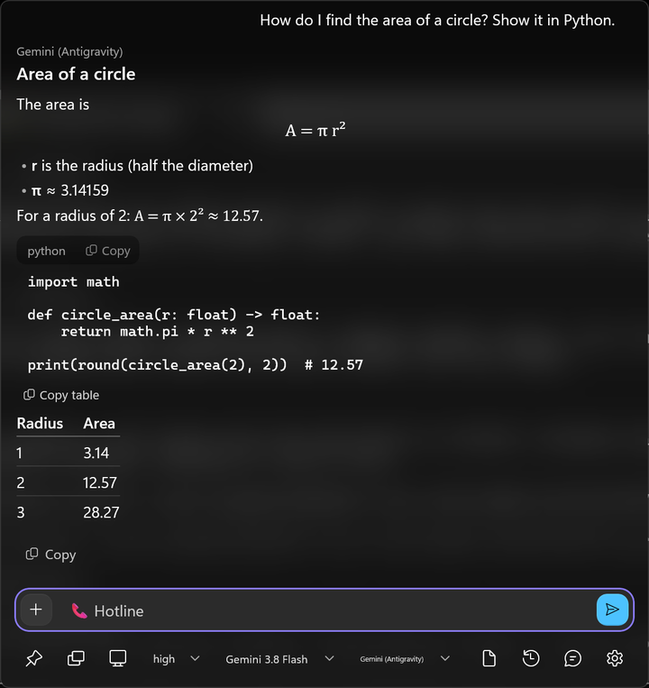
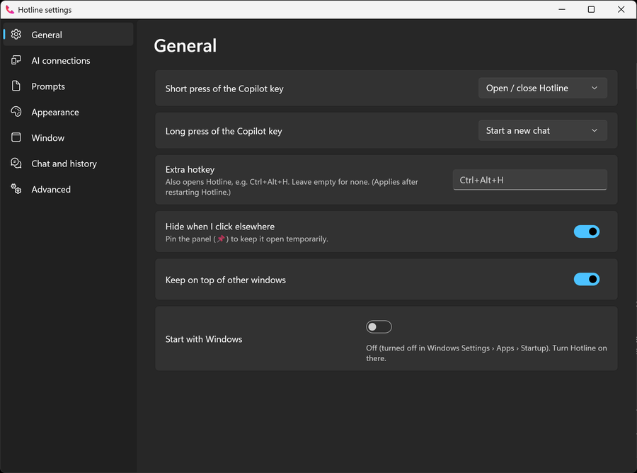

# Hotline

[](https://github.com/sponsors/PMARC14)
[](https://ko-fi.com/pmarc14)

**You are stuck with the key—might as well use it. Hotline turns the Windows Copilot key into a fast, native AI chat panel that talks to the AI *you* choose.**

Hotline works with the AI tools you already have (Claude Code, OpenAI Codex CLI, or Antigravity CLI and their sign-ins), any API key you bring, or a local model server, and keeps every setting in plain files.

<p align="center">
  
</p>

> Windows 11 22H2+ (x64 or ARM64). Apache-2.0.
>
> **Docs:** [Configuration](docs/configuration.md) · [Copilot key setup](#copilot-key-setup) · [Translations](#translations) · [Privacy](PRIVACY.md) · [Testing](docs/TESTING.md) · [Releasing](docs/RELEASING.md) · [Development](docs/HANDOFF.md)

## Features

- **The Copilot key**: short press opens/closes, long press starts a new chat or voice input (both configurable), plus an optional extra hotkey.
- **Your choice of AI**: Claude Code, OpenAI Codex CLI, and Antigravity CLI (`agy`) with their sign-ins; Anthropic, Gemini, and OpenAI-compatible APIs; local OpenAI-style servers (`llama.cpp`, LM Studio, vLLM). Switch Effort, Model, and Provider from the bar.
- **Native and light**: WinUI 3 with acrylic/mica, no embedded webview.
- **17 languages**: follows Windows or Settings › General (`en-US`, `es`, `fr`, `de`, `it`, `pt-BR`, `nl`, `pl`, `uk`, `tr`, `ja`, `ko`, `zh-Hans`, `zh-Hant`, `hi`, `id`, `vi`). See [Translations](#translations).
- **Rich answers**: Markdown, tables, code with Copy, math, inline SVG, and single-drag selection.
- **Screens and files**: capture a window, screen, or region; paste (`Ctrl+V`) or drop files; offline OCR reads image text for models without vision.
- **Selected text**: attached automatically via UI Automation without touching your clipboard.
- **Quick actions & memory**: `/` commands (`/bullets`, `/explain`, `/fix`, `/formal`, `/reply`, `/shorter`, `/summarize`, `/translate`, or custom `actions\*.md`) and `/remember`.
- **Voice**: set the long press to *Voice input*, hold the key, and talk.
- **Chat history & Continue in**: searchable (`🕘`, `Ctrl+↑`, `/resume`); CLI chats resume in their own history; **Continue in** opens chats in a terminal, Open WebUI, `llama.cpp`, LM Studio, or any URL or app.
- **Tools & notifications**: MCP servers (`mcp.json`) and Windows agent connectors for API connections (read-only tools run, others ask first); Windows notifications when background answers finish.
- **Your panel, your way**: Alt-drag to move/resize, pin, grow up or down, editable button rows and [panel shortcuts](docs/configuration.md#panel-shortcuts), open/close sounds, and Backup export/import (never API keys).

<p align="center">
  
</p>

## Install

### From the Microsoft Store

Search for **Hotline AI** in the Microsoft Store or run `winget install 9PMW5CR6G3BC`. Store builds are signed by Microsoft and update automatically (`winget upgrade`).

### From Releases

Download the `.msixbundle` from [Releases](https://github.com/PMARC14/Hotline/releases) and open it, or download `Hotline.appinstaller` for automatic updates.

> **GitHub releases are self-signed**, so Windows refuses them until you trust `Hotline.cer` once in an admin PowerShell:
> `Import-Certificate -FilePath .\Hotline.cer -CertStoreLocation Cert:\LocalMachine\TrustedPeople`

On first open, Hotline asks which AI to use (installed CLIs or an API key); nothing runs or is sent until you choose one.

### Copilot key setup

Windows only lets signed MSIX packages claim the Copilot key. Start Hotline once after installing, then assign it:

1. Open the Windows setting from Hotline (**Settings › General › Open Copilot key settings** or the first-run card), or open **Settings › Bluetooth & devices › Keyboard** (older builds: **Settings › Personalization › Text input › Customize Copilot key on keyboard**).
2. Choose **Custom** → **Hotline**. (Windows' **Right Ctrl**, **Context menu**, and **Search** choices do not reach Hotline.)

**Troubleshooting:**
- Confirm Hotline is still selected in Windows Settings (organizations can lock the key with the `SetCopilotHardwareKey` policy).
- No Copilot key or running an unpackaged build? Set `activation.fallbackHotkey` (e.g. `Ctrl+Alt+H`) in **Settings › General**, or use the tray icon.
- Tap and hold actions (`activation.tap` / `activation.hold`) are configured in **Settings › General** (see [configuration](docs/configuration.md)).

### From source

Requires [.NET SDK 10.0.401+](https://dotnet.microsoft.com/download):

```bash
git clone https://github.com/PMARC14/hotline
cd hotline
scripts/dev-cert.sh   # once: creates and trusts a self-signed dev certificate (UAC)
scripts/install.sh    # builds, signs, installs, and starts Hotline in the tray
```

## Quick start

- **Message box**: `Enter` sends, `Shift+Enter` adds a new line, `Ctrl+↑` in an empty box reopens the last chat, `Esc` stops a streaming answer or hides the panel, `Ctrl+N` starts a new chat.
- **Quick actions & attachments**: type `/` for actions, use `+` or `Ctrl+V` for files and captures, click `📌` to keep the panel open while dragging files in, or click `✕` to remove an attached selection chip.

| Connection | Requirements |
|---|---|
| Claude Code | [Claude Code](https://claude.com/claude-code) installed and signed in (run `claude` once) |
| OpenAI Codex | [Codex CLI](https://github.com/openai/codex) installed and signed in (`npm install -g @openai/codex`, `codex login`) |
| Antigravity (`agy`) | [Antigravity CLI](https://antigravity.google/cli) installed and signed in (run `agy` once) |
| Anthropic / Gemini / OpenAI-compatible | API key in **Settings › AI connections › Add connection** |
| Local | OpenAI-style server running (e.g. `llama-server` on `http://127.0.0.1:8080`) |

All settings, files, `agy` permissions, and MCP options are in **[docs/configuration.md](docs/configuration.md)**.

## What leaves your PC

Hotline has no server and collects no analytics. Messages go only to **the AI connection you chose** (with attachments, selected text, system prompt, `memory.md`, prior turns, and tool results) when you press Send. Config, history, and memory stay in `%USERPROFILE%\.hotline`; API keys stay in Windows Credential Locker and travel over HTTPS (HTTP only to localhost). OCR runs offline; voice uses Windows' online speech recognition. Full details: [PRIVACY.md](PRIVACY.md).

## Translations

English is the source; the other 16 languages are machine-drafted (RTL languages are not shipped yet). Fixes via pull request are welcome:

- **Where strings live**: `src/Hotline.Core/Text/Localization/Strings.resx` (English) and `Strings.<tag>.resx`, `src/Hotline.App/Strings/<tag>/Resources.resw` (`AppDescription` and Store package language registration), and `store/listings/<tag>.md`.
- **Keep intact**: every `{0}`, `{1}`, `{1:g}` placeholder, `\n` line breaks, product/file/key names (`Hotline`, `agy`, `/remember`, `mcp.json`, `settings.json`, `Ctrl+Alt+H`), and Windows' own settings wording.
- **Test**: `dotnet test --project tests/Hotline.Core.Tests/Hotline.Core.Tests.csproj` verifies that every language has every key, matching placeholders, and valid format strings.
- **Adding a language**:
  1. Copy `Strings.resx` to `Strings.<tag>.resx` and translate every `<value>`.
  2. Add `src/Hotline.App/Strings/<tag>/Resources.resw` with `AppDescription`.
  3. Add the tag to `Languages.Supported` (`src/Hotline.Core/Text/Localization/Languages.cs`), this README, and `general.language` in [configuration.md](docs/configuration.md) (and optionally `store/listings/<tag>.md`).
  4. Check layout with `scripts/pseudo-loc.sh` (sets `"general": { "language": "qps-ploc" }`; remove with `--remove`).

## Development

- **Code**: `src/Hotline.Core` (UI-free logic and unit tests) and `src/Hotline.App` (WinUI 3).
- **CI & releases**: PRs and pushes to `main` build and test; code merges to `main` publish a prerelease ([docs/RELEASING.md](docs/RELEASING.md)).
- **Docs**: [docs/TESTING.md](docs/TESTING.md) (tests and checklists), [docs/HANDOFF.md](docs/HANDOFF.md) (active development state).

## Support & License

Free and open source with no ads or tracking. Support development via [GitHub Sponsors](https://github.com/sponsors/PMARC14) or [Ko-fi](https://ko-fi.com/pmarc14) (also in **Settings › About**).

Apache-2.0 — see [LICENSE](LICENSE) and [THIRD-PARTY-NOTICES.md](THIRD-PARTY-NOTICES.md).
